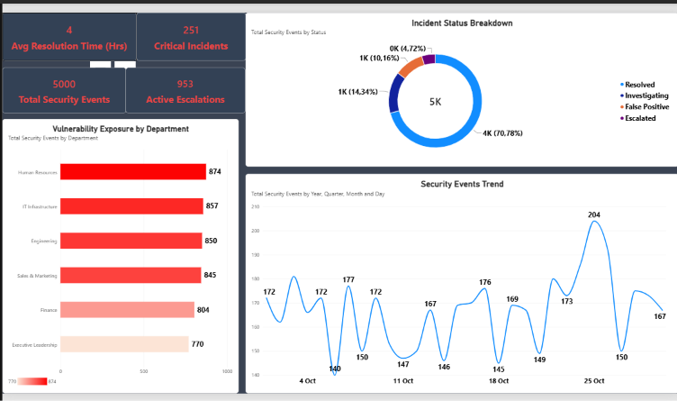
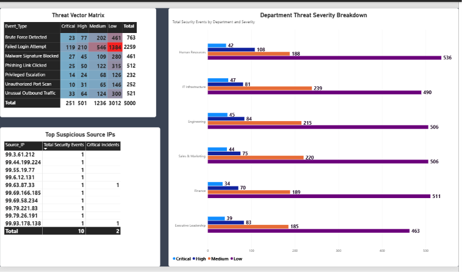
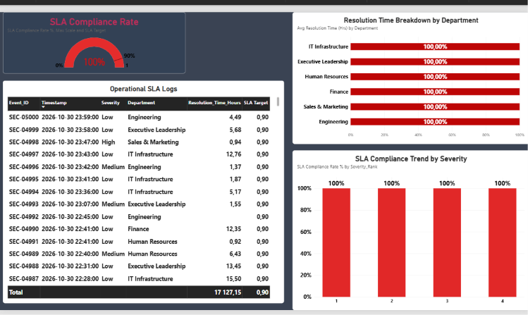

# 🛡️ Enterprise Security Operations & Threat Intelligence Analytics (SOC Dashboard)

An end-to-end Power BI cybersecurity analytics solution engineered to transform raw enterprise security events into actionable operational intelligence. This dashboard provides executive risk visualization, automated threat pattern identification, and incident response SLA compliance tracking for Security Operations Center (SOC) leaders.

---

## 📸 Executive Dashboard Overview

### Page 1: Executive Risk & Threat Overview
> *High-level visibility into total security events, active threat volumes, average resolution metrics, and severity distributions.*



---

### Page 2: Security Event & Threat Pattern Analysis
> *Deep-dive threat intelligence visualizer highlighting attack vectors, top offender source IPs, and event velocity patterns over time.*



---

### Page 3: Incident Response & Operational SLA Tracking
> *SOC performance monitor assessing operational efficiency, resolution hours by department, and SLA target compliance metrics.*



---

## 💡 Business Context & Key Features

* **Real-Time SOC KPI Tracking:** Instant tracking of active security incidents, high-priority threats, and average triage/resolution runtimes.
* **Threat Intelligence & Attack Vector Matrix:** Granular categorization across brute-force logins, malware outbreaks, phishing, unauthorized privilege escalation, and DDoS attempts.
* **Custom SLA Compliance Gauge:** Custom DAX-driven SLA target monitoring evaluating resolution turnarounds against organizational compliance limits (target: 90%+).
* **Granular Incident Audit Trail:** Interactive log inspection with reverse-chronological event sorting to support triage auditing.

---

## 🛠️ Data Pipeline & Architecture

1. **Synthetic Log Generation:** 5,000 enterprise-grade security events generated via custom Python scripting (`datetime`, `ipaddress`, `random` libraries).
2. **Power Query ETL Layer:** 
   * Handled data type conversions, null handling, and string trimming.
   * Leveraged US Culture locale conversions (`.` decimal separators) to convert runtime hours cleanly from string streams.
3. **DAX Data Modeling:**
   * Custom rank columns (`Severity_Rank`: Critical = 1, High = 2, Medium = 3, Low = 4) to ensure proper visual sorting.
   * Explicit target measures and dynamic ratio measures for gauge visual calibration.

---

## 🧮 Key DAX Measures

### **SLA Compliance Rate %**
```dax
SLA Compliance Rate % = 
VAR MetSLA = 
    CALCULATE(
        COUNTROWS('enterprise_security_logs'),
        'enterprise_security_logs'[Resolution_Time_Hours] <= 100 &&
        NOT(ISBLANK('enterprise_security_logs'[Resolution_Time_Hours]))
    )
VAR TotalResolved = 
    CALCULATE(
        COUNTROWS('enterprise_security_logs'),
        NOT(ISBLANK('enterprise_security_logs'[Resolution_Time_Hours]))
    )
RETURN
    IF(
        TotalResolved > 0,
        DIVIDE(MetSLA, TotalResolved),
        0
    )
```

🌟 Conclusion

This cybersecurity analytics suite demonstrates how raw log data can be converted into high-impact visual intelligence. By bridging the gap between executive-level risk reporting and granular incident triage, the dashboard equips IT leadership and security teams with the data needed to reduce Mean Time to Resolution (MTTR), enforce SLA compliance, and bolster enterprise defense posture.

Designed & Developed for Freelance Portfolio & Enterprise Security Analytics Operations.
    
    

    

    
